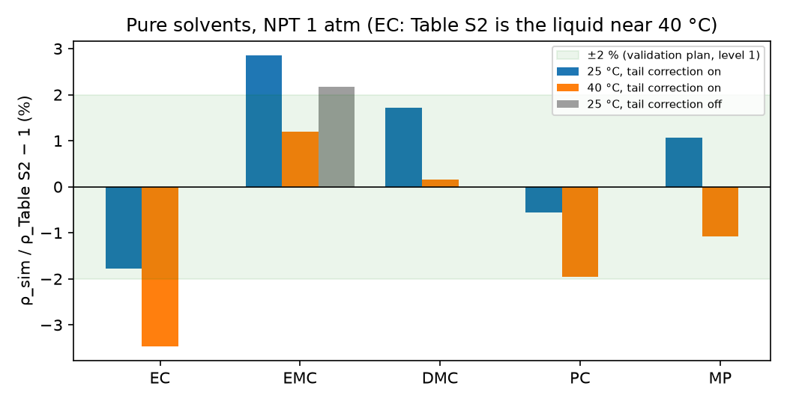
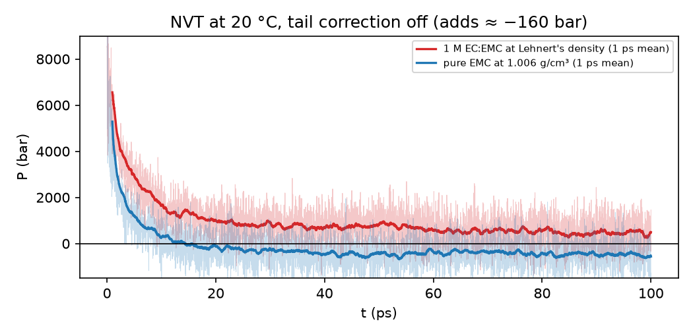
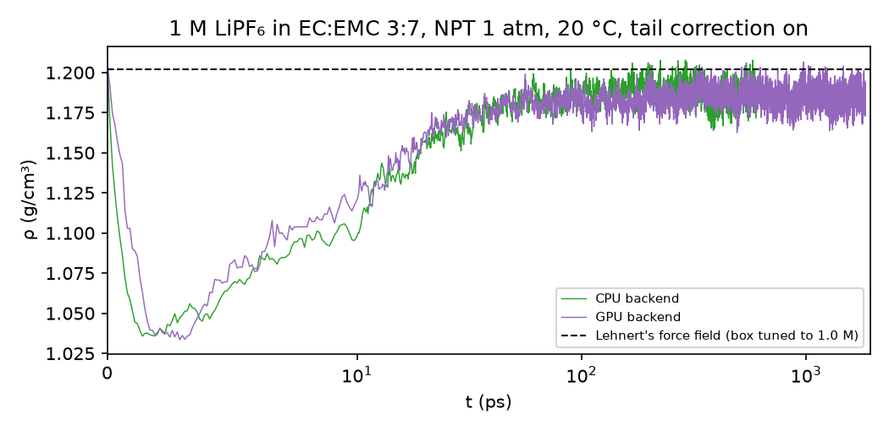
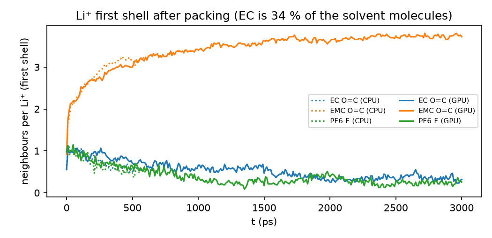

# A verified open MD engine for Li-ion battery electrolytes, and what an open OPLS-AA model does and does not reproduce

*Working draft, 2026-11-20. Results marked **pending** follow from runs in progress. Numbers come
from `data.json` (written by `figures.py` from the study data) and from the validation reports
cited. Not peer reviewed.*

## Abstract

- **Goal:** reproduce the transport data of LiPF₆ in carbonate solvents with our own simulation
  stack, and explain the measured trends from the molecular dynamics: Landesfeind & Gasteiger
  2019 (experiment) and Lehnert et al. 2025 (MD combined with experiment).
- **The stack:**
  - **UnitcellMD:** a modular engine with a bitwise-reproducible CPU reference backend and an
    OpenMM GPU backend that must reproduce it;
  - **ucmd-builder** for the systems;
  - **ucmd-analysis** for structure and Onsager transport.
- **The engine is verified independently of any force field:**
  - forces and energies agree with OpenMM to 10⁻¹³;
  - densities under pressure control agree with OpenMM within one standard error;
  - the GPU backend reproduces the CPU trajectory from an identical state;
  - mixed and double precision are statistically indistinguishable.
- **The open force field (LigParGen OPLS-AA for the solvents) fails in a characteristic way:**
  - pure EMC is 2.9 % too dense and EC 3.5 % too light; DMC, PC and MP lie within 2 %;
  - the 1 M EC:EMC electrolyte comes out 1.4 % lighter than with Lehnert's model;
  - the Li⁺ first shell excludes EC almost completely. We trace this to an asymmetry of the
    fitted carbonyl charges.
- **Consequence:** the model cannot yet be used to explain Li⁺ transport. The report states what
  the model explains, what it does not, and the calculations that decide how to improve it.

## 1. Introduction

**Transport parameters.** Newman-type battery models need the conductivity κ, the salt diffusion
coefficient D±, the transference number t₊ and the thermodynamic factor.
- Landesfeind & Gasteiger measured all four over 0.1–3 M and −10 to 50 °C for LiPF₆ in EC:DMC,
  EC:EMC and EMC:FEC.
- Lehnert et al. combined MD with experiment for EC:EMC, EC:DMC:PC and EC:EMC:MP. They fitted the
  ion-charge scaling ζ to κ at 1 M.

**The open dispute.** The two studies disagree on t₊:
- Landesfeind reports t₊ falling with c and turning negative below about 10 °C;
- Lehnert (MD and eNMR) finds it roughly constant near 0.37.

**What MD can add, beyond reproducing κ at the point where ζ was fitted:**
- *why* κ has a maximum and why the maximum shifts in the EC-free electrolyte;
- how much of κ's temperature dependence is viscosity and how much is ion association;
- how Li⁺ moves (with its shell or by exchange);
- whether charged ion clusters exist that could make t₊ negative.

All of this requires a model that is right where it matters, so this report first establishes
what the present model gets right and wrong.

## 2. Methods

### 2.1 Engine

- **UnitcellMD's CPU reference backend** (Rust):
  - velocity Verlet as an operator splitting;
  - Nosé–Hoover chains, CSVR, Langevin BAOAB;
  - an isotropic stochastic cell-rescaling barostat (Bernetti & Bussi 2020);
  - PME;
  - bitwise-reproducible results for any thread count and across checkpoint restarts.
- **The GPU backend** runs the same model in OpenMM 8.3 (OpenCL on an AMD Radeon VII):
  - it uses the engine's own operator splittings as custom integrators;
  - before every run it must reproduce a reference single point from the CPU backend (energy
    10⁻⁶, forces 10⁻⁵ in double precision, 2·10⁻⁴ in mixed).
- **Mixed precision** is admitted for thermostatted production by a statistical comparison with
  double precision (ADR 0012).

### 2.2 Model

- **Force-field family:** OPLS-AA conventions (geometric mixing, 1-4 scaling 0.5/0.5).
- **Solvents:** EC, EMC, DMC, PC, MP, FEC from LigParGen 3.0.1 with 1.14·CM1A-LBCC charges (each
  molecule parameterized on its own).
- **Ions:** Li⁺ from Jensen & Jorgensen 2006; PF₆⁻ from CL&P.
- **ζ = 0.75**, Lehnert's value for his model.
- **Nonbonded interactions:**
  - Lennard-Jones cut at 1.4 nm, with the analytic tail correction (as OPLS-AA was parametrized);
  - Coulomb by PME (real-space cutoff 1.4 nm, relative accuracy 10⁻⁵).
- **Sources of every parameter:** ADR 0009 and its amendments.

### 2.3 Protocol

- **Run settings,** as Lehnert's SI: 1 fs time step without constraints; Nosé–Hoover thermostat
  τ = 0.1 ps; barostat τ_p = 1 ps; 1 atm.
- **Systems:** packed with Packmol at the target density and minimized.
- **Studies:** each one is a reproducible study folder (plan, runs, provenance).

### 2.4 Analysis

- **Densities:** block averages over the second half of each run.
- **Pressure:** the virial pressure (atomic on the CPU, molecular on the GPU; equal means).
- **Li⁺ shells:** per-frame counts of carbonyl O and PF₆ F within the first minimum of g(r).
- **Ion association:** Li⁺–PF₆⁻ clusters are the connected components of the contact graph
  (Li–P within the first minimum of g(r)). Each frame's composition is recorded, with block
  errors.
- **Transport (pending):** Onsager coefficients from collective mean squared displacements in the
  barycentric frame (Fong et al. 2020), κ, t₊ (COM frame), Nernst–Einstein κ and ionicity, with
  block errors.

## 3. Results

### 3.1 The engine is verified independently of the force field

| test | result | source |
|---|---|---|
| energies and forces against OpenMM, 7036-atom electrolyte | 1.6·10⁻¹³ (energy), 10⁻¹³ (forces) | `ucmd-engine/validation/m2a` |
| virial against a finite-difference strain derivative | 10⁻⁶ | m2a |
| NVE time-step scaling of the energy error (velocity Verlet: 4) | 4.2 | m2a |
| argon density, C-rescale against OpenMM's Monte Carlo barostat | −0.15 % (1.0 σ); volume fluctuations within 2 % | `validation/npt-argon` |
| ideal-gas volume ⟨V⟩ = (N+1)kT/P₀ | 8.705 ± 0.043 vs 8.698 nm³ | unit test |
| bitwise reproducibility (threads, restarts, rerun after a crash) | identical | m2a; the 59.2 ps rerun of 2026-11-18 |
| GPU backend against CPU, same state, NVE | ΔU < 0.008 kJ/mol over 0.5 ps; ΔE_tot < 0.006 kJ/mol over 1 ps | `validation/e37-openmm` |
| GPU mixed against double precision, pure EMC NPT 1 ns | all averages within 1.6 σ; drift of H 0.014 kJ/mol/ps | `validation/e37-precision` |

**Throughput, 7000 atoms:**
- CPU, 16 threads: about 1 ns/day;
- GPU, double precision: 34 ns/day;
- GPU, mixed precision: about 55 ns/day.

### 3.2 Pure solvents: linear carbonates too dense, EC too light

NPT at 1 atm, 0.5 ns, tail correction on, mean over the second half with block errors.
Deviations are from Lehnert SI Table S2.

| solvent | ρ_sim 25 °C (g/cm³) | ρ_sim 40 °C (g/cm³) | Table S2 | deviation 25 °C | deviation 40 °C |
|---|---|---|---|---|---|
| EC | 1.2975 ± 0.0003 (supercooled) | 1.2753 ± 0.0011 | 1.321 | −1.8 % | **−3.5 %** |
| PC | 1.1972 ± 0.0011 | 1.1804 ± 0.0007 | 1.204 | −0.6 % | −2.0 % |
| DMC | 1.0873 ± 0.0003 | 1.0708 ± 0.0014 | 1.069 | +1.7 % | +0.2 % |
| EMC | 1.0347 ± 0.0003 | 1.0180 ± 0.0008 | 1.006 | **+2.9 %** | +1.2 % |
| MP | 0.9248 ± 0.0013 | 0.9052 ± 0.0007 | 0.915 | +1.1 % | −1.1 % |

**Which temperature Table S2 refers to.**
- Table S2 does not state a temperature. Manufacturer data are usually given at 20–25 °C.
- **The EC value is different:**
  - EC melts at 36 °C, so 1.321 g/cm³ must be a liquid density;
  - it matches the experimental density at 39 °C, 1.3214 g/cm³ (DIPPR, compiled in the
    Caleman et al. 2012 SI);
  - so the like-for-like comparison for EC is at 40 °C. A 1 K offset changes ρ by about 0.1 %.
- With that reading, at the temperature that applies:
  - DMC (+1.7 %), PC (−0.6 %) and MP (+1.1 %) pass the ±2 % criterion;
  - **EMC (+2.9 %) and EC (−3.5 %) fail it.**

**Pattern.**
- The linear carbonates are too dense: EMC +2.9 %, DMC +1.7 %.
- The cyclic ones are too light: EC −3.5 %, PC −0.6 %.
- Opposite signs within one parameter source point to the parameters of individual molecules,
  not to a common convention or to the engine. The engine reproduces OpenMM densities within
  one standard error (§3.1).
- **The functional form is not the problem:**
  - the OPLS-AA atom types distributed with GROMACS reproduce EC at 39 °C to 0.05 %:
    1.3207 against 1.3214 g/cm³ (Caleman 2012; candidate 2 in
    [forcefield-survey.md](../forcefield-survey.md));
  - a different parameter set in the same functional form does what ours does not.

**Thermal expansion.** The simulated α = −d ln ρ/dT between 25 and 40 °C:

| solvent | α (10⁻³ K⁻¹) |
|---|---|
| EC | 1.15 |
| EMC | 1.09 |
| DMC | 1.02 |
| PC | 0.94 |
| MP | 1.43 |

There is no cited experimental α yet, so these values are recorded, not judged (A8).

**Checks.**
- Without the tail correction, EMC is 1.0278 g/cm³ (+2.2 %). The correction adds the dispersion
  attraction beyond the cutoff and raises the density, as expected.
- The pressure test at fixed density agrees: pure EMC held at 1.006 g/cm³ shows
  −435 ± 21 bar (tail correction off; Figure 1).
- The mean pressure of the NPT runs is within 2σ of the 1 atm target in 9 of 10 runs.
  - MP at 40 °C reads 21 ± 7 bar.
  - At a compressibility of order 10⁻⁴ bar⁻¹, 20 bar shifts ρ by about 0.2 %, which is small
    against the deviations above.
  - The block errors of a 0.25 ns window probably understate the pressure noise.
- **Whether LJ parameters or charges cause the errors is open.** A5 (ΔH_vap) and B3 decide it.

### 3.3 The electrolyte: density settles fast, structure slowly

**At fixed volume,** the pressure of a freshly packed and minimized box starts near 8000 bar:
- **First 0.05 ps:** about half of this disappears. With all bonds at their rest length, the
  kinetic pressure of about +3600 bar has no bond tension to balance it yet, and equipartition
  halves the temperature at the same time.
- **Afterwards:** the remainder relaxes over 100 ps and more.
- **At Lehnert's density** (1.202 g/cm³ from 47 ion pairs at 1.0 M), our electrolyte still shows
  +546 ± 47 bar over 50–100 ps, still falling (tail correction off; about +390 bar with it).

**Under NPT at 1 atm:**
- the box first expands (the pressure overshoot) and then settles within about 100 ps;
- the density is 1.1862 ± 0.0016 g/cm³ (CPU, 0.3–0.6 ns) and 1.1850 ± 0.0008 g/cm³ (GPU,
  1.5–3 ns);
- that is **1.4 % below Lehnert's model**;
- the two backends agree.

The electrolyte error is small because the solvent errors of §3.2 partly cancel; it is not
evidence that the model is right.

### 3.4 The Li⁺ shell excludes EC

**After packing,** each Li⁺ has about one neighbour of each kind. Over 2 ns, EMC carbonyl O
replaces both EC carbonyl O and PF₆⁻ F.

| run | t | EC O=C | EMC O=C | PF₆⁻ F |
|---|---|---|---|---|
| CPU | 0.6 ns (last frame) | 0.55 | 3.26 | 0.51 |
| GPU | 3 ns (last frame) | 0.32 | 3.72 | 0.26 |

**Averaged over 1.5–3 ns (GPU, 300 frames; contacts within the first minimum of each g(r)):**

| per Li⁺ | EC O=C | EMC O=C | PF₆⁻ (P within 0.33 nm) |
|---|---|---|---|
| mean contacts | 0.38 | 3.69 | 0.07 |

- The most common shells are four EMC (49 %), four EMC plus one EC (17 %), and three EMC (8 %).
- **Free ions dominate:** 93.5 ± 0.6 % of Li⁺ have no PF₆⁻ in contact. Contact pairs hold 6.2 ±
  0.5 %, and larger clusters well under 1 %. (Over 0.3–0.6 ns in the CPU run, with a cutoff of
  0.38 nm, it was 70 % free.)

**Two observations:**
1. **The shell needs nanoseconds,** two orders of magnitude longer than the density. Short
   equilibrations would report unconverged structure, and any transport run must start after it.
2. **EC is strongly under-represented.** It is 34 % of the solvent molecules but only about 9 %
   of the carbonyl O at Li⁺, and still falling. Mixed-carbonate electrolytes are usually
   described with EC enriched in the Li⁺ shell (a literature source for the quantitative
   expectation is still to be added).

**The likely cause is in the parameters.** LigParGen charges each molecule separately:
- EC's carbonyl O gets −0.393 e, EMC's −0.531 e (the carbonyl C +0.579 and +0.588 e);
- a Li⁺ at 0.21 nm responds mostly to that one charge, not to the molecular dipole. In these
  templates' conformers, EC's dipole is 5.81 D and EMC's 0.58 D (point charges).
- The open OPLS-AA atom-type set for EC (Caleman et al. 2012) gives a smaller dipole (5.28 D) on
  the same geometry. Its carbonyl O is stronger (−0.50 e), because it puts positive charge on the
  carbonyl C instead of the hydrogens
  ([forcefield-survey.md](../forcefield-survey.md)).

Calculation A4 (Li⁺ in pure EC and pure EMC) will test this directly.

### 3.5 Transport (pending)

- **Run:** the pilot (20 ns NVT at 20 °C from the equilibrated state of §3.3) runs tonight.
- **It will report:**
  - D of every species;
  - L₊₊, L₋₋ and L₊₋;
  - κ, t₊ (COM frame) and the ionicity κ/κ_NE, with block errors;
  - above all, the noise of the cross term L₊₋ after 20 ns, which sets the length and number
    of replicas of the campaign.
- **Interpretation:** its κ and t₊ inherit the shell error of §3.4 and a ζ fitted to a
  different model. They are a test of the method, not of the physics.

## 4. Discussion: what the model explains, and what it does not

**Explained or reproduced:**
- the equilibration time scales: density about 0.1 ns, solvation shells about 2 ns or more;
- the physical origin of the large initial pressures (a minimization and equipartition artefact,
  not a property of the force field);
- the electrolyte density, within 1.4 % of Lehnert's model, but for partly cancelling reasons.

**Not reproduced, with a probable cause:**
- pure-solvent densities to 2 % for EMC (+2.9 %) and EC (−3.5 % at 40 °C); DMC, PC and MP pass.
  A published OPLS-AA set reproduces EC, so the parameters are at fault, not the functional form;
- the Li⁺ shell composition (EC excluded), plausibly from the carbonyl charge asymmetry.

**Not yet tested (pending or needing tools):** the plan's table lists each with its ID.
- κ, t₊, D (A3, then C);
- viscosity (A6);
- dielectric constant (A7);
- ΔH_vap (A5);
- the temperature dependence (A8, C3).

**Out of reach by construction:**
- freezing (MD stays a supercooled liquid);
- electronic polarization beyond a constant ζ, which already fails at 3 M in Lehnert's work;
- interphase effects behind the t₊ dispute.

**How to improve:**
- **Solvent charges and LJ parameters** (decision D1): a published, cited OPLS-AA carbonate set,
  or charges from one consistent quantum-chemical method. Either is checked against densities,
  ΔH_vap and the Li⁺ preference test.
- **Then:** fit ζ once, and test everything else against data that were not fitted.

## 5. Outlook

[calculation-plan.md](../calculation-plan.md) lists every calculation with its purpose, cost and
status:
- a corrected model;
- a ζ fit;
- concentration and temperature series of 1 M EC:EMC (about 1 µs of GPU time);
- decompositions that turn measured totals into mechanisms: correlations behind the κ maximum,
  viscosity against association in κ(T), cluster contributions to t₊.

## Data and provenance

| content | study folder (`studies/`) |
|---|---|
| figures 1, 3, 4 | `2026-11-17_pressure-at-reference-density`, `2026-11-17_electrolyte-npt-{cpu,gpu}` |
| figure 2 | `2026-11-17_pure-solvent-densities` (tail off), `2026-11-17_solvent-densities-tail-on` |

- **Provenance:** every run stores its exact `run.toml`, engine version, package hash and (on the
  GPU) the device, OpenMM, ROCm and container versions.
- **Engine:** ucmd 0.0.0 (c9098de), branches `e27-barostat` and `e37-openmm`.

### References

- J. Landesfeind, H. A. Gasteiger, J. Electrochem. Soc. 166, A3079 (2019).
- L. Lehnert et al., J. Electrochem. Soc. 172, 050523 (2025), and SI.
- E. R. Logan et al., J. Electrochem. Soc. 165, A3350 (2018).
- M. Bernetti, G. Bussi, J. Chem. Phys. 153, 114107 (2020).
- K. D. Fong et al., Macromolecules 53, 9503 (2020).
- L. S. Dodda et al., Nucleic Acids Res. 45, W331 (2017); J. Phys. Chem. B 121, 3864 (2017)
  (LigParGen).
- C. Caleman et al., J. Chem. Theory Comput. 8, 61 (2012), and SI (experimental ρ, ΔH_vap, ε compiled
  from DIPPR, CRC and others; OPLS-AA results).
- K. P. Jensen, W. L. Jorgensen, J. Chem. Theory Comput. 2, 1499 (2006).
- J. N. Canongia Lopes, A. A. H. Pádua, J. Phys. Chem. B 108, 16893 (2004).
